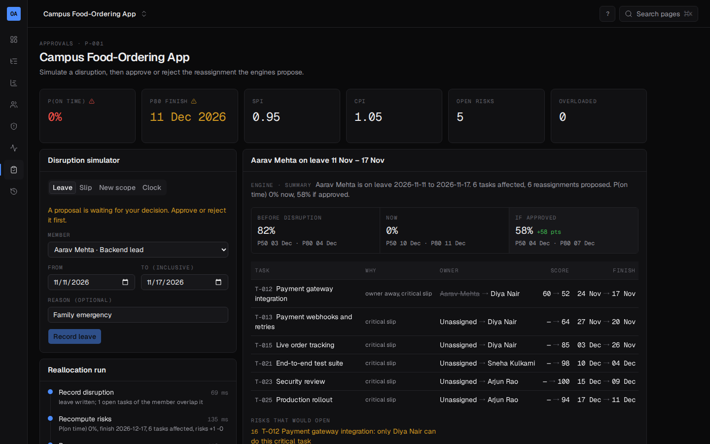
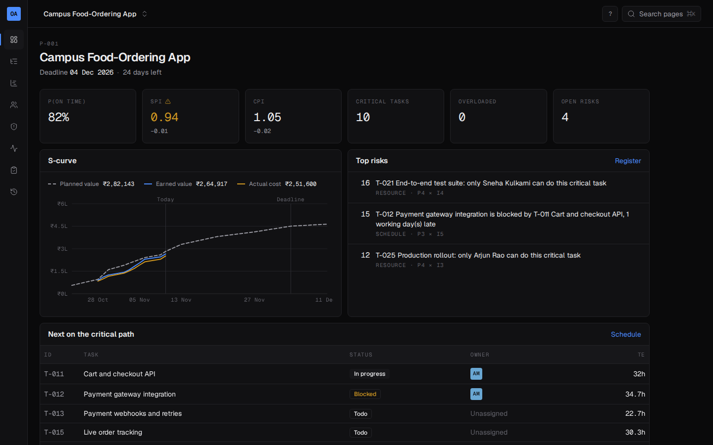
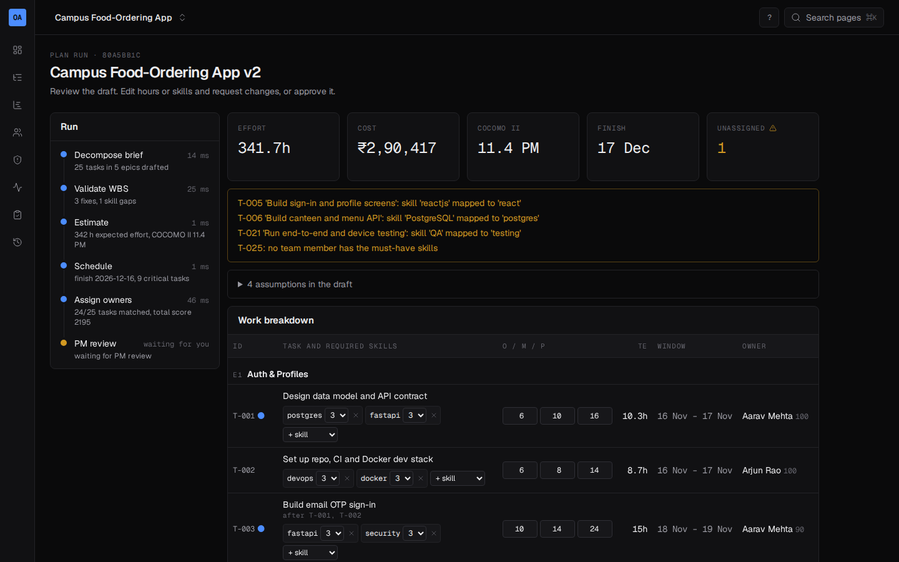
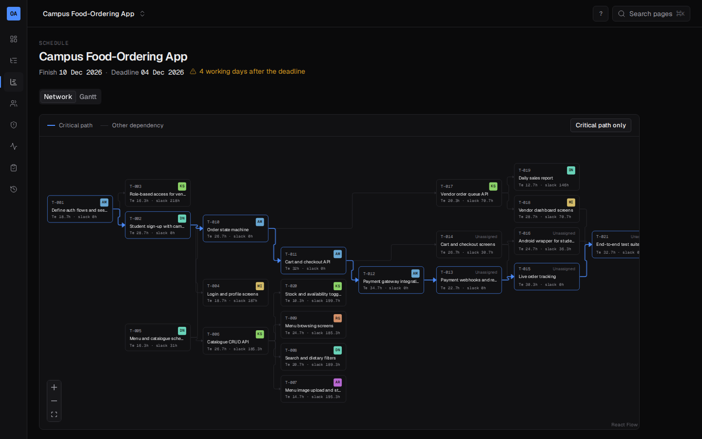
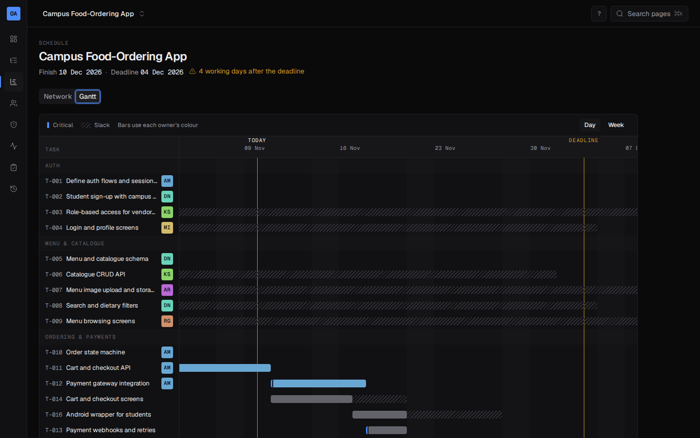
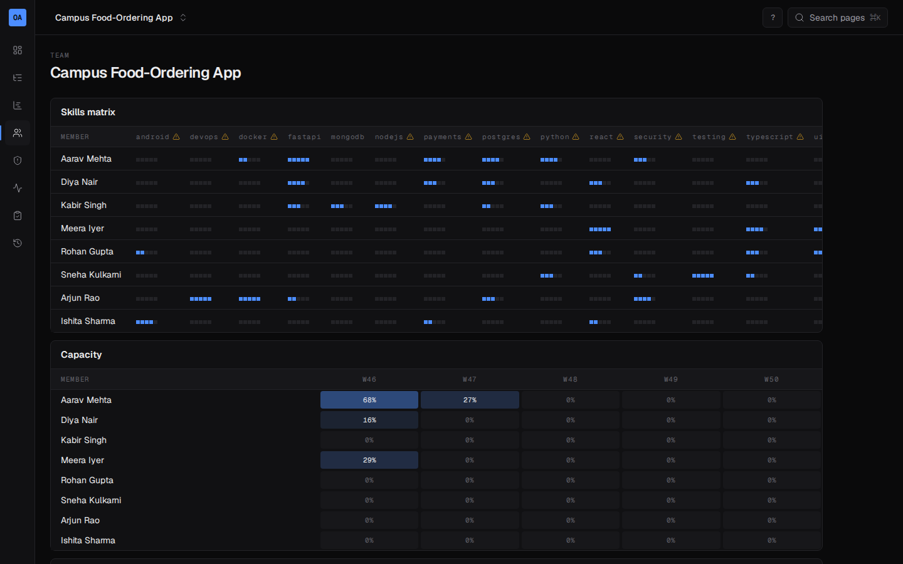
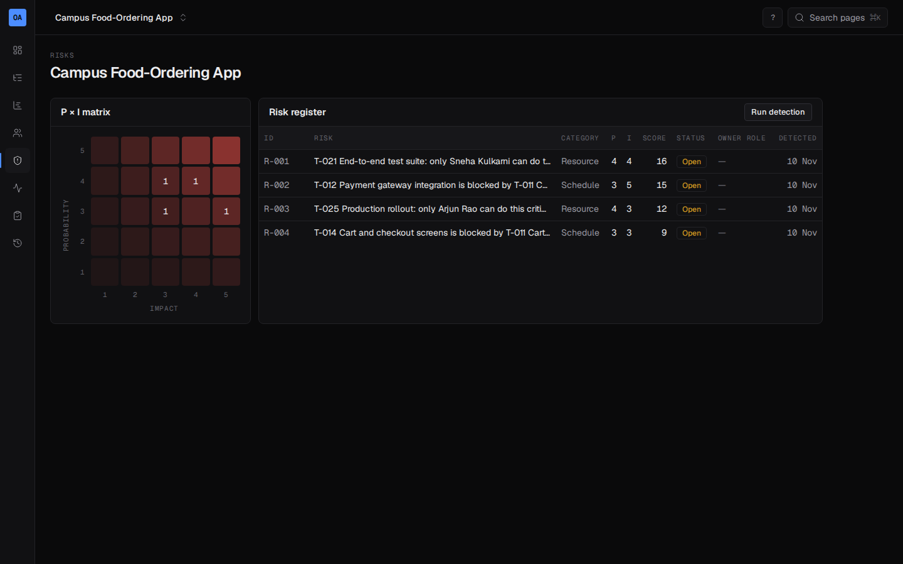
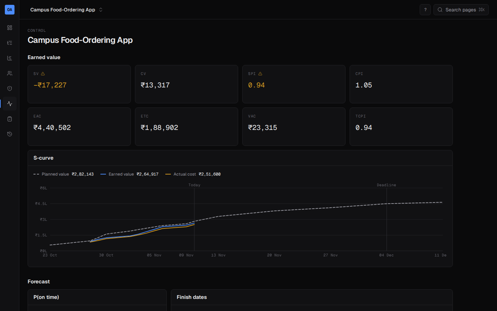
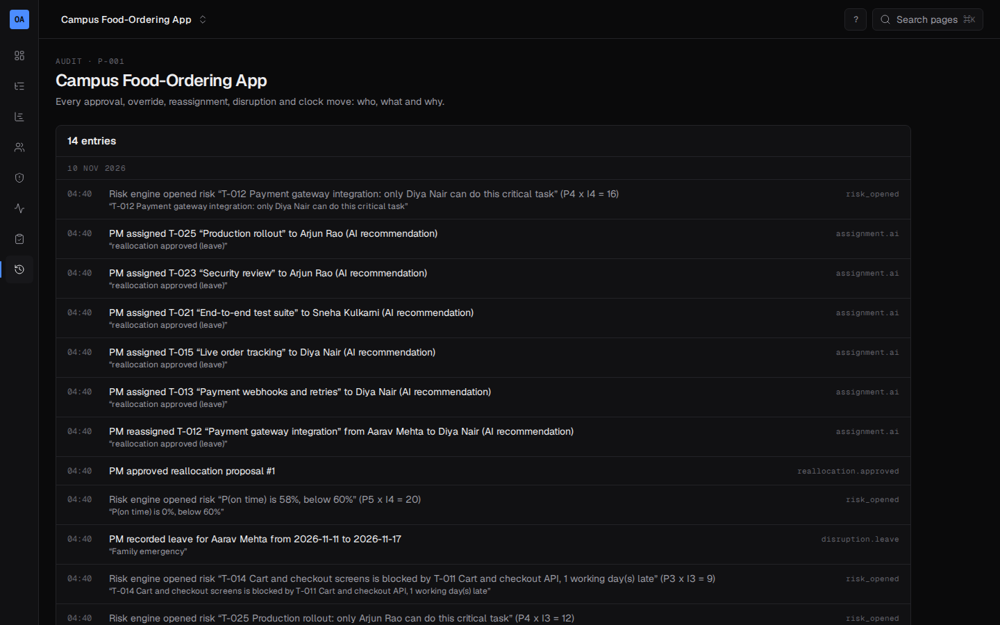
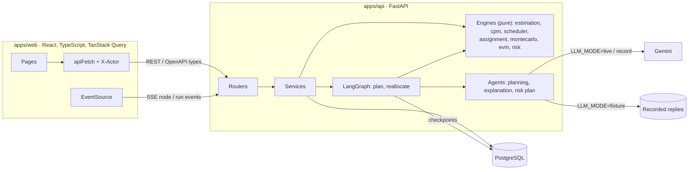

# OrchestrAI

[](https://github.com/PRIYANSHU-RTHR/SPM_Course_Project/actions/workflows/ci.yml)

AI-assisted software project management. A plain-English brief becomes a work breakdown structure, which is estimated with PERT and COCOMO II, scheduled with the Critical Path Method, and staffed by an explainable assignment engine. A Monte Carlo forecast, earned value and a live risk register track it. When someone goes on leave or a task slips, the system proposes a reallocation that the project manager approves or rejects.

**The model plans and explains; deterministic engines compute every number.** Gemini writes the WBS draft (structure and three-point estimates as *inputs*) and prose. Every KPI on screen comes from pure, tested Python engines.

University Software Project Management course project. Built by a team of three; see [Team](#team).



<details>
<summary>More screenshots</summary>

| | |
|---|---|
|  Overview: KPIs, S-curve, next critical tasks, top risks |  Brief → plan: live workflow timeline and editable WBS |
|  Dependency network with the critical path |  Resource-levelled Gantt with slack and owners |
|  Skills matrix and capacity heatmap |  P×I matrix and risk register |
|  EVM KPIs, S-curve and forecast |  Audit log: who, what and why |

</details>

## What it does

1. **Plan.** Paste a brief. A LangGraph workflow streams its steps live (decompose → validate → estimate → schedule → assign) and stops at a **PM review**. There you can edit hours and skills (the plan is re-estimated), approve it (the project is created), or reject it.
2. **Estimate.** PERT per task, COCOMO II for the whole project, cost against budget.
3. **Schedule.** CPM forward and backward pass, slack and critical path, then a resource-constrained schedule that respects owners, capacity and leave.
4. **Assign.** Every task gets a 0–100 fit score from skill, capacity and balance. The Hungarian method finds the best batch assignment, and each recommendation comes with a grounded explanation.
5. **Forecast.** 5,000 Beta-PERT Monte Carlo runs give P(on time), P50/P80/P95 and task criticality, adjusted for owners, leave and progress.
6. **Control.** Earned value (PV, EV, AC, SPI, CPI, EAC, ETC, VAC, TCPI) on a simulated clock. A rule-based risk register uses P×I scoring, with RMMM plans.
7. **React.** The disruption simulator records leave, a slip or new scope and computes a reallocation proposal (before / now / if approved). The PM approves or rejects it, and every decision lands in the audit log.

## SPM syllabus → feature mapping

| SPM topic | Where it lives |
|---|---|
| Project planning, scope, WBS | Planning agent → PM-review WBS (epic → task), editable before approval |
| Effort and cost estimation | `engines/estimation.py`: PERT per task, COCOMO II for the project, cost vs budget |
| Activity network, CPM, slack | `engines/cpm.py` → network graph with the critical path |
| Gantt, scheduling | `engines/scheduler.py` (resource-constrained) → Gantt view |
| Resource allocation and levelling | `engines/assignment.py` (score + Hungarian), capacity heatmap, greedy vs optimal |
| Risk identification and RMMM | `engines/risk.py` (7 rules) + risk agent, P×I matrix, register |
| Schedule risk (Monte Carlo) | `engines/montecarlo.py`: CDF, P50/P80/P95, criticality index |
| Monitoring and control, EVM | `engines/evm.py` → S-curve and KPI cards, simulated clock |
| Change control | Reallocation proposals with approve / reject, immutable audit log |
| Team organisation | Skills matrix, availability, bus-factor warnings |

## Architecture



- **Postgres** stores the data, the audit log and the LangGraph checkpoints, so a run paused for the PM survives restarts.
- **SSE** streams each workflow node's start, end, duration and summary to the UI.
- **OpenAPI → TypeScript** (`pnpm gen:api`) keeps the web types generated, never hand-written.
- **Fixture mode** replays recorded model replies, so the demo and the tests never need a key.

Data model and the disruption → approval sequence diagram: [docs/architecture.md](docs/architecture.md).

## Formulas

| What | Formula |
|---|---|
| PERT | te = (o + 4m + p) / 6, σ = (p − o) / 6 |
| COCOMO II (post-architecture) | PM = A · KSLOC^E · ΠEM, E = B + 0.01 · ΣSF, TDEV = C · PM^F, F = D + 0.2 (E − B); A 2.94, B 0.91, C 3.67, D 0.28; KSLOC from effort at 10 LOC/h |
| CPM | ES/EF forward pass, LS/LF backward pass, total slack = LS − ES, critical ⇔ slack = 0 |
| Assignment score | 100 · (0.60 · skill_fit + 0.25 · capacity_fit + 0.15 · balance); eligible = every must-skill ≥ required − 1 and on leave ≤ 50% of the window |
| Batch assignment | Hungarian method (`linear_sum_assignment`) on cost = 100 − score, per dependency wave |
| Monte Carlo | duration = o + (p − o) · Beta(α, β) with PERT mean; resource-adjusted by the scheduler's finish with owners, leave and progress minus the network-only finish |
| EVM | SV = EV − PV, CV = EV − AC, SPI = EV / PV, CPI = EV / AC, EAC = BAC / CPI, ETC = EAC − AC, VAC = BAC − EAC, TCPI = (BAC − EV) / (BAC − AC) |
| Risk | score = probability (1–5) × impact (1–5); 7 rules: overload, bus factor, SPI, CPI, P(on time), late predecessor, skill gap |

## Evaluation

Assignment strategies on the demo seed and two synthetic teams (`make evaluate`, fixed seeds; full tables in [docs/evaluation.md](docs/evaluation.md)):

| Team | Strategy | Mean score | Utilisation σ | Makespan (days) | P(on time) |
|---|---|--:|--:|--:|--:|
| Demo seed (25 tasks, 8 people) | random | 80.8 | 0.250 | 38 | 0% |
| | greedy | 90.2 | 0.120 | 38 | 0% |
| | optimal | 90.7 | 0.132 | 38 | 0% |
| Synthetic 2 (39 tasks, 9 people) | random | 64.2 | 0.535 | 41 | 0% |
| | greedy | 68.1 | 0.470 | 39 | 0% |
| | optimal | 67.9 | 0.381 | **30** | **18%** |

Disruption recovery on the demo project (measured with `make demo`; deadline 04 Dec; the simulator's default one-week leave):

| Moment | P(on time) | P80 finish |
|---|--:|---|
| Before the disruption | 82% | 04 Dec |
| Aarav Mehta on leave for a week | 0% | 11 Dec |
| After approving the 6 proposed reassignments | 58% | 07 Dec |

Forecast sanity on the seed: CPM finish 253 h, PERT critical path 253 ± 9.8 h, Monte Carlo P50 253.7 h, P80 263.2 h.

## Run

You need Docker with Compose v2.17 or newer, and `make`. You don't need an API key, a `.env` file, Python or Node.

```bash
git clone https://github.com/PRIYANSHU-RTHR/SPM_Course_Project.git
cd SPM_Course_Project
make demo
```

`make demo` builds the images and starts Postgres, the API and the web app. It waits until all three are healthy, then runs the migrations and loads the demo project, "Campus Food-Ordering App". When it's done it prints the URLs:

| What     | URL                         |
|----------|-----------------------------|
| Web app  | http://localhost:8080       |
| API      | http://localhost:8000       |
| API docs | http://localhost:8000/docs  |

The demo runs with `LLM_MODE=fixture`: AI steps replay recorded model replies from `apps/api/fixtures/llm/`, so they need no key and give the same output every time. On the new-project page, **Use the demo brief** loads the brief that has a recording. The click-by-click demo is in [docs/demo-script.md](docs/demo-script.md).

- **Reset:** run `make demo` again. It reloads the demo data, which wipes the demo database.
- **Stop:** `make demo-down`. The database volume is kept.
- **Port in use?** Override the ports, e.g. `POSTGRES_PORT=5433 make demo API_PORT=8001 WEB_PORT=8081`. The web app picks up the new API URL when its container starts.
- **Shortcuts:** `⌘K` command palette, `g p` projects, `g a` approvals, `?` for the full list.

### Local development

```bash
cp .env.example .env              # then edit if needed
make db-up && make seed           # Postgres in Docker, demo data
make api                          # API with reload on :8000 (needs uv)
make web                          # Vite dev server on :5173 (needs Node 22 + pnpm)
make lint && make test            # same checks as CI; `make cov` adds the coverage gate
```

### Recording LLM fixtures

Only needed after a prompt, a schema or the demo brief changes, because the old recording then no longer matches.

```bash
export GEMINI_API_KEY=...          # or put it in .env
make record-fixtures
```

This seeds the demo team and runs the demo brief through the planning workflow with `LLM_MODE=record`. It writes the reply to `apps/api/fixtures/llm/`; commit the new file. The model comes from `GEMINI_MODEL`, default `gemini-3.8-flash`.

## Testing

- **API:** 282 tests against a real Postgres in CI:
  - engines with hand-checked textbook numbers and edge cases
  - routers and services (happy path and failures)
  - workflows in fixture mode with an in-memory checkpointer
  - migrations, with an up/down drift check
- **Coverage:** 100% line and branch on `app/engines` (CI fails under 80%); 97% for the whole API.
- **Web:** 98 Vitest tests: pure model helpers, plus page smoke tests with a mocked `fetch` and `EventSource` (overview, brief-to-plan, approvals, audit).
- **End to end:** the brief-to-plan and disruption-to-approval flows were run in headless Chromium against the Docker stack at 1440 and 390 px, with no console errors.
- **CI:** [`.github/workflows/ci.yml`](.github/workflows/ci.yml): ruff, pytest with Postgres and the coverage gate; typecheck, lint, test and build for the web app.

## Deploying (optional)

The Docker images are self-contained: the API image migrates on start, and the web image takes its API URL at runtime (`API_URL` → `/config.js`). A typical split:

- **API and DB** on Render or Railway: build `apps/api/Dockerfile`. Set `DATABASE_URL`, `LLM_MODE=fixture` (or `live` with `GEMINI_API_KEY` and `GEMINI_MODEL`), and `CORS_ORIGINS=<web URL>`.
- **Web** as the `apps/web/Dockerfile` image with `API_URL=<api URL>`, or as a static site from `pnpm build` with `VITE_API_URL` set at build time.

It is not deployed from this repository; nothing here holds hosting credentials.

## Known limitations

- **Proposals optimise fit, not finish date.** The assignment engine maximises skill fit, capacity and balance. For some leave windows the proposed owners finish *later* than the current ones; the approvals card warns the PM when that happens.
- **The forecast shift is a constant.** It is resource-adjusted by the scheduler's finish with versus without owners. Resource contention is not sampled per run.
- **Reassignment moves PV.** Planned value comes from the schedule with the current owners, so approving a reassignment re-baselines PV, and SPI can move. A frozen baseline would be more textbook.
- **Unowned to-do tasks don't progress.** In the simulated clock, 8 of the seed's 25 tasks start without an owner, so SPI falls as the clock advances until they are assigned.
- **One user role.** No authentication; every action is recorded as `PM` (header `X-Actor`).

## Team

| Who | Built |
|---|---|
| Priyanshu Rathore | Repo, API skeleton, data model and migrations, CRUD APIs, risk engine, LLM client and fixture mode, planning and reallocation workflows, Step 24 API, tests and CI, Docker and the one-command demo, brief-to-plan and approvals UI, docs |
| Manveer Anand | Estimation, CPM, assignment (Hungarian), resource-constrained scheduler, Monte Carlo, EVM engines, planning, explanation and risk agents, evaluation |
| Ravi Kumawat | Seed data, web scaffold and design system, overview, network and Gantt, team and assignment views, risk, EVM and forecast views |

## Repository layout

```
apps/api/    FastAPI app: routers → services → engines (pure) · agents · workflows · migrations · tests
apps/web/    React app: src/features/<area>, src/components (ui = shadcn), src/lib (api client, format)
infra/       docker-compose.yml (db, api, web)
docs/        architecture.md · demo-script.md · evaluation.md · screenshots/
```
