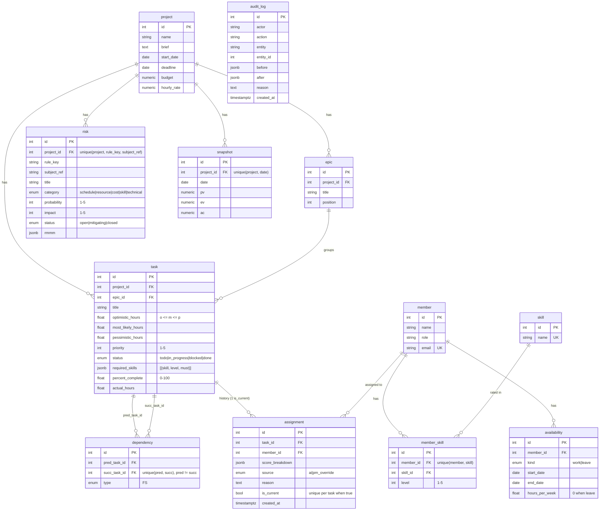

# Architecture

## Data model

PostgreSQL 16, managed with SQLAlchemy 2 models (`apps/api/app/models/`) and Alembic migrations (`apps/api/migrations/`).

- **Keys:** every table has an integer surrogate primary key (`id`).
- **Time:** timestamps are `timestamptz` set by the database clock (UTC). Calendar values use `date`.
- **Units:** effort is in hours as `float`. Money (`budget`, `hourly_rate`, `pv`/`ev`/`ac`) is `numeric`, in INR with 2 decimal places.

`audit_log` points at the changed row through `entity` + `entity_id` (no foreign key). This lets it record any table, and audit rows survive deletes.
