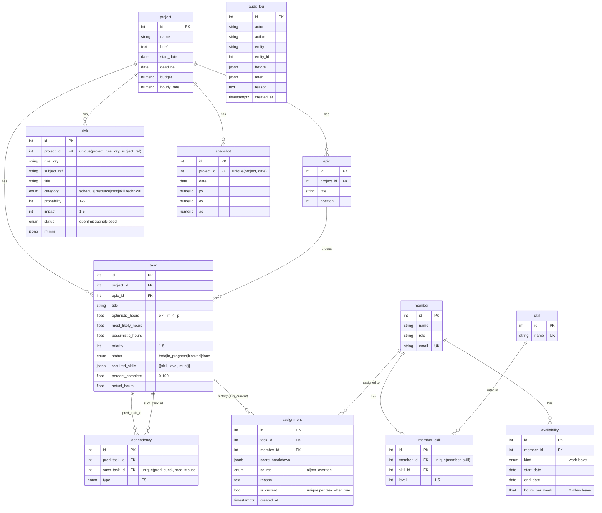
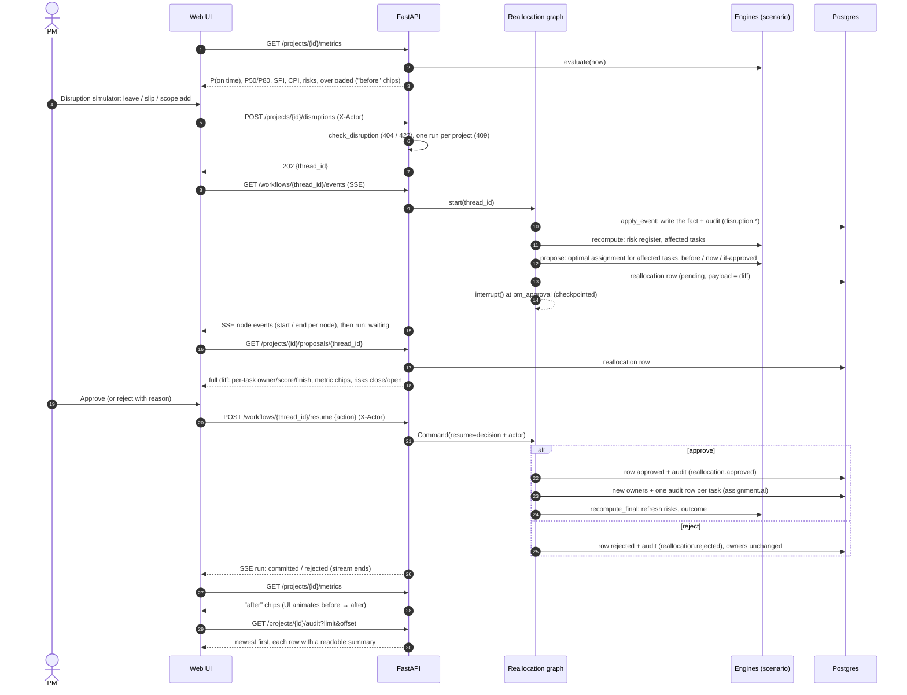

# Architecture

## Data model

PostgreSQL 16, managed with SQLAlchemy 2 models (`apps/api/app/models/`) and Alembic migrations (`apps/api/migrations/`).

- **Keys:** every table has an integer surrogate primary key (`id`).
- **Time:** timestamps are `timestamptz` set by the database clock (UTC). Calendar values use `date`.
- **Units:** effort is in hours as `float`. Money (`budget`, `hourly_rate`, `pv`/`ev`/`ac`) is `numeric`, in INR with 2 decimal places.

`audit_log` points at the changed row through `entity` + `entity_id` (no foreign key). This lets it record any table, and audit rows survive deletes.

## Disruption → approval flow

A disruption is a fact: it is written (and audited) as soon as it is posted. The PM approves or rejects only the reassignment that follows. The reallocation graph (`app/workflows/reallocate.py`) runs in a worker thread and pauses once, at `pm_approval`, with `interrupt()`. Its state is checkpointed in Postgres under `thread_id`. Every number in the proposal and in `/metrics` comes from the engines through `services/scenario.py`. Every PM request can send an `X-Actor` header (default `PM`), which becomes `audit_log.actor`.

